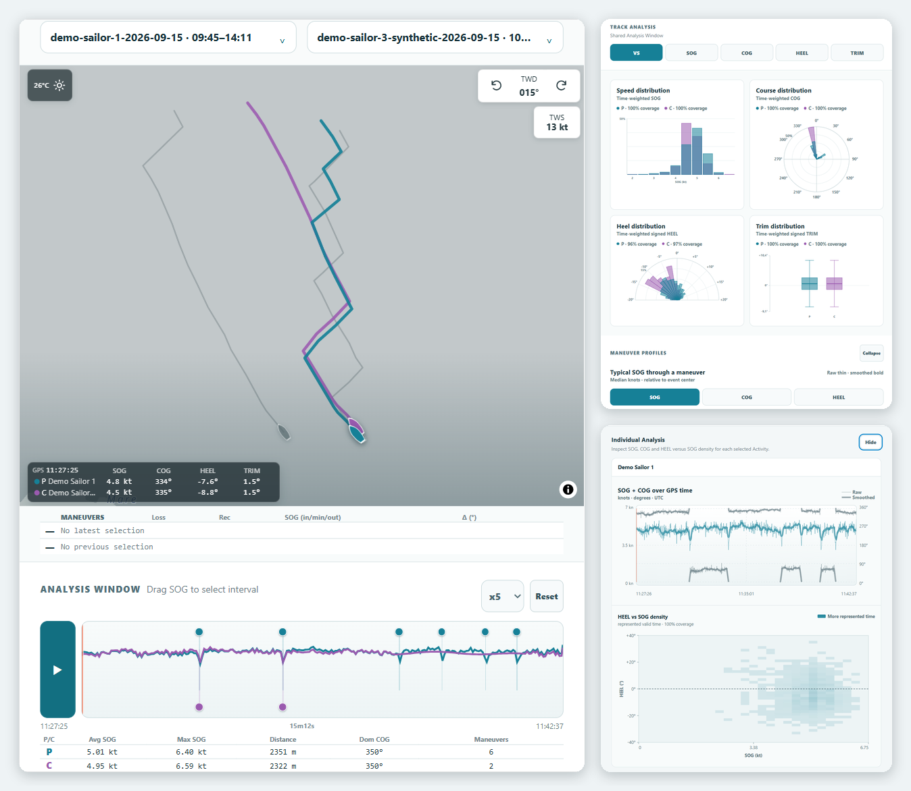

# TackBar

**Collaborative post-sailing debriefing for sailors, coaches and racing teams.**

TackBar is an early-stage open-source project focused on making post-sailing analysis simple, collaborative and immediate.

The core idea is simple:

**Sail → share your track → compare → debrief.**

Instead of manually collecting GPS files from several sailors and trying to align them afterwards, TackBar aims to automatically group tracks that belong to the same sailing session and make them available for collaborative review.

   
  Session Viewer with demo data

**Links:** [Website](https://tackbar.eu) · [Latest release](https://github.com/maxsail-project/tackbar/releases/latest) · [CHANGELOG](CHANGELOG.md) · [Open Issues](https://github.com/maxsail-project/tackbar/issues) · [ROADMAP](ROADMAP.md) · [Español](#versión-en-español)

---

## Why TackBar?

A lot of useful discussion happens after sailing:

* Why was one boat faster on a particular leg?
* Who gained on the first beat?
* Where did two boats separate?
* What happened around the start?
* Was the difference tactical, positional or simply speed?

Today, this often means manually exporting files, exchanging them between sailors and loading them into different analysis tools.

TackBar aims to reduce that friction.

> **Sail first. TackBar after.**

The debrief starts when the sailing stops.

---

## Current pilot workflow

`Sail → share track → email ingestion → Sailor → Activity → Session → capability URL → shared Session Viewer → collaborative debrief`

The accepted implementation supports **Vakaros CSV, CSV.GZ, VKX and VKX.GZ,
plus plain GPX** tracks
through the OVH mailbox `share@tackbar.eu`.
TackBar reviews that mailbox automatically on the current single-VPS systemd
schedule; Admin **Review mailbox now** remains the manual fallback. Admin also
manages consent and shares Session links. The normalized sender email resolves
the Sailor; each received track becomes an Activity with optional Boat context
and is automatically matched to a Session.

Consent controls shared visibility, not technical ingestion or Session matching.
Only Activities of currently `ACTIVE` Sailors appear in shared Sessions.
Access uses a valid Session capability URL, without a general Sailor login.

Protected Admin also offers an exceptional operator/testing upload path for
one file up to 16 MiB and an explicitly selected existing `ACTIVE` Sailor.
Accepted uploads process independently of the browser and send no automatic
emails. Email remains the normal Sailor sharing path.

Each supported track is limited to 16 MiB as received; Vakaros CSV.GZ and
VKX.GZ may expand to at most 160 MiB. Shared Session responses identify
Activities by sporting context and do not expose the full Sailor email or the
internal Sailor ID.

GPX requires one track and one nonempty segment, strictly increasing UTC,
median sample interval at most 2 seconds, nearest-rank P95 at most 5 seconds,
and no adjacent gap over 10 seconds. Compressed GPX and extension telemetry mapping
are unsupported. FIT and generalized multi-provider ingestion remain future
work. See [Ingestion and Data](docs/current/ingestion-and-data.md).

| Input | Files | What TackBar reads |
| --- | --- | --- |
| Vakaros CSV | `.csv`, `.csv.gz` | Time, position, speed, course, true heading, heel and trim |
| Vakaros VKX | `.vkx`, `.vkx.gz` | Time, position, speed and course; heading, heel and trim only when the device orientation evidence allows |
| Plain GPX | `.gpx` | Time and position; speed and course are derived from positions; no heading, heel or trim |

Other devices and formats (FIT, compressed GPX, other providers) are not
supported yet.

---

## Sailor, Boat and Activity identity

For current email ingestion, the normalized sender email resolves a Sailor.
The Sailor has a stable internal TackBar identity; email remains an external
ingestion identity.

Boat is a separate domain entity. A Sailor may have an optional default Boat
for new ingestion, while each Activity records the Sailor and the Boat used
when that context is known. Activity remains the stable identity of one
received track.

---

## Automatic session detection

TackBar attempts to identify activities that belong to the same sailing session using:

* activity date;
* start and end time;
* temporal overlap;
* geographic proximity;
* GPS track location.

If no compatible session exists, TackBar creates a new session automatically.

The goal is that sailors do not need to create a session manually before sailing.

The first sailor simply sends a track. Subsequent tracks from nearby sailors are automatically associated with the same session when time and location are compatible.

---

## Activity data

The current supported Vakaros exports provide data such as:

* timestamp;
* latitude;
* longitude;
* speed over ground;
* course over ground;
* true heading;
* heel;
* trim.

Current format support is described in the pilot workflow above.

TackBar is intended to remain device-independent.

---

## Architecture

The current architecture is intentionally simple:

`Email/provider → ingestion → parsing/normalization → Sailor → Activity + optional Boat → Session matching → persistence → FastAPI read API → Session Viewer`

Current technology and persistence:

* **Frontend:** React + TypeScript Session Viewer
* **Backend:** Python + FastAPI
* **Persistence:** JSON metadata plus filesystem originals and normalized tracks
* **Activity ingestion:** OVH IMAP adapter with provider-independent downstream processing
* **Target experience:** mobile-first web application that also works naturally on tablets

The Session Viewer reads Sessions, Activities and tracks actually persisted by
the backend; public sanitized TEST data exercises the same runtime and API
path. SQLite is not a prerequisite for this PoC.

The Viewer offers:

* comparison of one or two Activities over a shared GPS/UTC Analysis Window,
  with synchronized replay on the map;
* SOG, COG, HEEL and TRIM signal charts and distributions;
* Individual Analysis per Activity (SOG + COG over time, HEEL × SOG density);
* neutral maneuver evidence: HIGH when heading is available, LOW from course
  and speed;
* source-aware wind references, Session location and, when available,
  historical conditions;
* other visible Activities as passive fleet context on the map, while analysis
  stays limited to two.

Maneuver evidence is not a track-quality rating or an accuracy guarantee. See
[Session Viewer](docs/current/session-viewer.md) and
[Analytics](docs/current/analytics.md) for behavior, availability and
limitations.

The ingestion layer is intended to remain independent from the analytics layer.

This makes it possible to add new activity sources without changing the core sailing analysis.

---

## Relationship with MaxSail Analytics

TackBar builds on sailing analytics concepts and technical experimentation previously developed in **MaxSail Analytics**.

MaxSail Analytics explored areas such as:

* GPS track visualization;
* comparison between sailing tracks;
* speed and heading analysis;
* time-based track selection;
* wind-oriented visualization;
* sailing-session analysis.

TackBar is a new and independent product direction.

It does not inherit the Streamlit application architecture of MaxSail Analytics.

Reusable TackBar sailing-analysis logic may evolve as an independent Python
analytics/domain layer or library when needed. This direction does not claim a
mature standalone analytics library is already delivered.

The focus is instead on:

* collaborative debriefing;
* automatic activity ingestion;
* mobile and tablet usage;
* session-based analysis;
* simple post-sailing workflows;
* support for multiple sailors and boats.

---

## Project status

<!--
For the Release Preparer: "Project status", "Releases and next direction" and their
Spanish counterparts ("Estado del proyecto", "Releases y próxima dirección") are
version-independent by design. Do not add release numbers, release summaries or
"candidate" wording; the latest published release is shown in GitHub Releases.
-->

**Controlled real-sailing pilot.** The current published release is shown under
[Releases → Latest](https://github.com/maxsail-project/tackbar/releases/latest).

The delivered baseline includes OVH mailbox ingestion through
`share@tackbar.eu`, track-first onboarding and explicit consent, Personal
TackBar, capability-based shared Session access and neutral maneuver analytics
integrated into the collaborative Viewer. It also includes richer native-SVG
signal and distribution comparison plus per-Activity Individual Analysis.
Accepted increments add plain GPX, protected Admin upload, HIGH/LOW maneuver
evidence, source-aware Viewer wind references and controlled feedback for
actionable track-email failures. Human questions go to `hello@tackbar.eu`.
Publication is established by
immutable tags and GitHub Releases; production deployment is established by
successful execution of the exact-release deployment workflow, as described
in the [production runbook](docs/production-runbook.md).

The delivered v0.5.x baseline includes Sailor / optional Boat context, automatic
Session matching, one/two-Activity comparison, a shared GPS/UTC Analysis
Window, synchronized replay and SOG/COG/HEEL/TRIM analysis.

The debrief is collaborative because sailors inspect and discuss the Session
together around a phone or tablet; it does not require built-in chat or
messaging.

See the [CHANGELOG](CHANGELOG.md) for delivered changes and the
[pilot participation and consent conditions](docs/pilot-participation-consent.md).

The project is not currently affiliated with or endorsed by Garmin, Vakaros or any other device manufacturer.

## Releases and next direction

The latest published release is always shown under
[Releases → Latest](https://github.com/maxsail-project/tackbar/releases/latest).
Delivered changes are recorded in the [CHANGELOG](CHANGELOG.md); the
[current specification index](docs/current/index.md) owns functional behavior.

Open [GitHub Issues](https://github.com/maxsail-project/tackbar/issues) are the
canonical pending-work inventory, and the GitHub Project provides its physical
ordering without assigning release scope. See also the [ROADMAP](ROADMAP.md).

Historical requirements and decisions:
[v0.7 requirements](docs/v0.7-collaborative-debrief-analytics-requirements.md),
[analytics decisions](docs/v0.7-decisions.md) and
[mailbox operations decisions](docs/mailbox-operations-decisions.md).

## Public website

[tackbar.eu](https://tackbar.eu) is the public TackBar website. The application
and its source code are developed in [this GitHub repository](https://github.com/maxsail-project/tackbar),
separately from the marketing website in [tackbar-web](https://github.com/maxsail-project/tackbar-web).

---

## Open source

TackBar source code is released under the [Mozilla Public License 2.0 (MPL-2.0)](LICENSE).

Open-source code does not make participant information, emails, GPS tracks or
private pilot/runtime data open data.

---

# Versión en español

**Debriefing colaborativo después de navegar para regatistas, entrenadores y equipos.**

TackBar es un proyecto open-source en fase inicial cuyo objetivo es hacer que el análisis posterior a una navegación sea simple, colaborativo e inmediato.

La idea central es sencilla:

**Navegar → compartir el track → comparar → hacer debriefing.**

En lugar de recopilar manualmente archivos GPS de distintos regatistas e intentar alinearlos posteriormente, TackBar busca agrupar automáticamente los tracks que pertenecen a una misma sesión de navegación y ponerlos a disposición de los participantes para analizarlos conjuntamente.

   
  Session Viewer con datos de demostración

**Enlaces:** [Web](https://tackbar.eu) · [Última release](https://github.com/maxsail-project/tackbar/releases/latest) · [CHANGELOG](CHANGELOG.md) · [Issues abiertos](https://github.com/maxsail-project/tackbar/issues) · [ROADMAP](ROADMAP.md) · [English](#tackbar)

---

## ¿Por qué TackBar?

Muchas de las conversaciones más útiles ocurren después de navegar:

* ¿Por qué un barco fue más rápido en un tramo?
* ¿Quién ganó metros en la primera ceñida?
* ¿Dónde se separaron dos barcos?
* ¿Qué ocurrió alrededor de la salida?
* ¿La diferencia fue táctica, de posicionamiento o simplemente de velocidad?

Actualmente, esto suele implicar exportar archivos manualmente, intercambiarlos entre regatistas y cargarlos en diferentes herramientas de análisis.

TackBar pretende reducir esa fricción.

> **Primero navegamos. Después, TackBar.**

El debriefing empieza cuando termina la navegación.

---

## Flujo actual del piloto

`Navegar → compartir track → ingesta por email → Sailor → Activity → Session → capability URL → Session Viewer compartido → debriefing colaborativo`

La implementación aceptada admite tracks **Vakaros CSV, CSV.GZ, VKX y VKX.GZ,
además de GPX sin comprimir**
mediante el buzón OVH `share@tackbar.eu`.
TackBar revisa ese buzón automáticamente mediante el calendario systemd actual
del VPS; **Review mailbox now** en Admin sigue siendo la alternativa manual.
Admin también gestiona el consentimiento y comparte los enlaces de Session. El
email remitente normalizado resuelve el Sailor; cada track recibido se convierte
en una Activity con contexto Boat opcional y se asocia automáticamente a una
Session.

El consentimiento controla la visibilidad compartida, no la ingesta técnica ni
el Session matching. Sólo las Activities de Sailors actualmente `ACTIVE`
aparecen en Sessions compartidas. El acceso utiliza una capability URL de
Session válida, sin un sistema general de login de Sailor.

Admin protegido también ofrece una carga excepcional para operadores/pruebas:
un archivo de hasta 16 MiB y un Sailor existente `ACTIVE` seleccionado
explícitamente. La carga aceptada se procesa independientemente del navegador
y no envía emails automáticos. El email sigue siendo el canal habitual.

Cada track admitido tiene un límite de 16 MiB recibidos; Vakaros CSV.GZ y
VKX.GZ pueden expandirse como máximo a 160 MiB. Las respuestas de Sessions
compartidas identifican las Activities por contexto deportivo y no exponen el
email completo del Sailor ni su ID interno.

GPX exige un track y un segmento no vacío, UTC estrictamente creciente,
intervalo mediano entre muestras de como máximo 2 segundos, P95 de rango más cercano
de como máximo 5 segundos y ningún salto superior a 10 segundos. GPX comprimido y el mapeo
de telemetría de extensiones no están soportados. FIT y proveedores adicionales
siguen siendo trabajo futuro. Consulta
[Ingestion and Data](docs/current/ingestion-and-data.md).

| Entrada | Archivos | Qué lee TackBar |
| --- | --- | --- |
| Vakaros CSV | `.csv`, `.csv.gz` | Hora, posición, velocidad, rumbo, heading verdadero, escora y trimado |
| Vakaros VKX | `.vkx`, `.vkx.gz` | Hora, posición, velocidad y rumbo; heading, escora y trimado solo cuando la evidencia de orientación del dispositivo lo permite |
| GPX sin comprimir | `.gpx` | Hora y posición; velocidad y rumbo se derivan de las posiciones; sin heading, escora ni trimado |

Otros dispositivos y formatos (FIT, GPX comprimido, otros proveedores) todavía
no están soportados.

---

## Identidad de Sailor, Boat y Activity

En la ingesta actual por email, el remitente normalizado resuelve un Sailor. El
Sailor tiene una identidad interna estable de TackBar; el email sigue siendo
una identidad externa de ingesta.

Boat es una entidad de dominio separada. Un Sailor puede tener un Boat por
defecto opcional para nuevas ingestas y cada Activity registra el Sailor y el
Boat utilizado cuando se conoce ese contexto. Activity mantiene la identidad
estable de un track recibido.

---

## Detección automática de sesiones

TackBar intenta identificar las actividades que pertenecen a una misma sesión utilizando:

* fecha de la actividad;
* hora de inicio y finalización;
* solapamiento temporal;
* proximidad geográfica;
* localización del track GPS.

Si no existe una sesión compatible, TackBar crea una nueva automáticamente.

El objetivo es que los regatistas no tengan que crear previamente una sesión antes de salir a navegar.

El primer regatista simplemente envía su track. Los siguientes tracks se asocian automáticamente a la misma sesión cuando la hora y la ubicación son compatibles.

---

## Datos de actividad

Las exportaciones Vakaros admitidas actualmente proporcionan información como:

* timestamp;
* latitud;
* longitud;
* velocidad sobre el fondo;
* rumbo sobre el fondo;
* heading verdadero;
* escora;
* trimado.

El soporte actual de formatos se describe en el flujo del piloto anterior.

TackBar pretende ser independiente del dispositivo utilizado.

---

## Arquitectura

La arquitectura actual se mantiene deliberadamente sencilla:

`Email/proveedor → ingesta → parsing/normalización → Sailor → Activity + Boat opcional → matching de Session → persistencia → API FastAPI de lectura → Session Viewer`

Tecnología y persistencia actuales:

* **Frontend:** Session Viewer con React + TypeScript
* **Backend:** Python + FastAPI
* **Persistencia:** metadata JSON más originales y tracks normalizados en el sistema de archivos
* **Ingesta de Activity:** adaptador IMAP OVH con procesamiento posterior independiente del proveedor
* **Experiencia objetivo:** aplicación web mobile-first que también funciona de forma natural en tablet

El Session Viewer lee Sessions, Activities y tracks realmente persistidos por
el backend; los datos TEST públicos y sanitizados ejercitan la misma ruta
runtime/API. SQLite no es un requisito previo para esta PoC.

El Viewer ofrece:

* comparación de una o dos Activities sobre una Analysis Window GPS/UTC
  compartida, con replay sincronizado en el mapa;
* charts y distribuciones de señal SOG, COG, HEEL y TRIM;
* Individual Analysis por Activity (SOG + COG en el tiempo, densidad HEEL × SOG);
* evidencia neutral de maniobras: HIGH cuando hay heading, LOW a partir de
  rumbo y velocidad;
* referencias de viento con procedencia, ubicación de la Session y, cuando
  existan, condiciones históricas;
* otras Activities visibles como contexto pasivo de flota en el mapa, mientras
  el análisis sigue limitado a dos.

La evidencia de maniobras no califica la calidad global del track ni garantiza
precisión. Consulta [Session Viewer](docs/current/session-viewer.md) y
[Analytics](docs/current/analytics.md) para comportamiento, disponibilidad y
limitaciones.

La capa de ingesta permanecerá separada de la capa analítica.

De esta forma podrán incorporarse nuevas fuentes de actividad sin modificar el núcleo de análisis de navegación.

---

## Relación con MaxSail Analytics

TackBar se apoya en conceptos de analítica de vela y experimentación técnica desarrollados previamente en **MaxSail Analytics**.

MaxSail Analytics exploró áreas como:

* visualización de tracks GPS;
* comparación entre tracks de navegación;
* análisis de velocidad y rumbo;
* selección temporal de tramos;
* visualización orientada al viento;
* análisis de sesiones de navegación.

TackBar representa una nueva dirección de producto independiente.

No hereda la arquitectura de aplicación Streamlit de MaxSail Analytics.

La lógica reutilizable de análisis de vela de TackBar podrá evolucionar como
una capa o librería independiente de analítica/dominio en Python cuando sea
necesario. Esta dirección no afirma que ya exista una librería independiente
madura.

El foco pasa a estar en:

* debriefing colaborativo;
* ingesta automática de actividades;
* uso desde móvil y tablet;
* análisis basado en sesiones;
* simplicidad del flujo posterior a la navegación;
* soporte para varios regatistas y barcos.

---

## Estado del proyecto

**Piloto controlado con navegaciones reales.** La release publicada actual figura en
[Releases → Latest](https://github.com/maxsail-project/tackbar/releases/latest).

La baseline entregada incluye ingesta del buzón OVH mediante
`share@tackbar.eu`, onboarding iniciado por track y consentimiento explícito,
Personal TackBar, acceso compartido a Sessions mediante capability y analítica
neutral de maniobras integrada en el Viewer colaborativo. También incluye una
comparación más rica de señales y distribuciones en SVG nativo e Individual
Analysis por Activity. Los incrementos aceptados añaden GPX sin comprimir,
carga protegida en Admin, evidencia HIGH/LOW de maniobras, referencias de viento
del Viewer con procedencia y respuestas controladas ante fallos accionables de
tracks enviados por correo. Las consultas humanas van a `hello@tackbar.eu`.
Los tags
inmutables y GitHub Releases establecen la publicación; la ejecución correcta
del workflow para esa release establece el despliegue técnico, según el
[runbook de producción](docs/production-runbook.md).

La baseline v0.5.x entregada incluye Sailor / contexto Boat opcional, Session
matching automático, comparación de una/dos Activities, Analysis Window GPS/UTC
compartida, replay sincronizado y análisis SOG/COG/HEEL/TRIM.

El debriefing es colaborativo porque los regatistas inspeccionan y comentan la
Session juntos alrededor de un móvil o tablet; no requiere chat ni mensajería
integrados.

Consulta el [CHANGELOG](CHANGELOG.md) para los cambios entregados y las
[condiciones de participación y consentimiento](docs/pilot-participation-consent.md).

Actualmente el proyecto no está afiliado ni respaldado por Garmin, Vakaros ni ningún otro fabricante de dispositivos.

## Releases y próxima dirección

La última release publicada figura siempre en
[Releases → Latest](https://github.com/maxsail-project/tackbar/releases/latest).
Los cambios entregados se registran en el [CHANGELOG](CHANGELOG.md); el
[índice de especificaciones actuales](docs/current/index.md) define el
comportamiento funcional.

Los [Issues](https://github.com/maxsail-project/tackbar/issues) abiertos son el
inventario canónico de trabajo pendiente y GitHub Project aporta su orden
físico sin asignar alcance de release. Consulta también el [ROADMAP](ROADMAP.md).

Requisitos y decisiones históricos:
[requisitos v0.7](docs/v0.7-collaborative-debrief-analytics-requirements.md),
[decisiones de analítica](docs/v0.7-decisions.md) y
[decisiones operativas del buzón](docs/mailbox-operations-decisions.md).

## Web pública

[tackbar.eu](https://tackbar.eu) es la web pública de TackBar. La aplicación y
su código fuente se desarrollan en [este repositorio GitHub](https://github.com/maxsail-project/tackbar),
por separado de la web de presentación en [tackbar-web](https://github.com/maxsail-project/tackbar-web).

---

## Open source

El código fuente de TackBar se publica bajo la [Mozilla Public License 2.0 (MPL-2.0)](LICENSE).

El código abierto no convierte la información de participantes, emails, tracks
GPS ni datos privados del piloto/runtime en datos abiertos.

---

# About the author / Sobre el autor

Hi! I'm **Maximiliano Mannise**, a software engineer working in the industry since 1998, a data and analytics enthusiast, and a passionate sailor.

I've been sailing for more than 20 years: first for fun, later in cruising regattas, and since 2020 in the **Snipe dinghy class**.

My professional background naturally leads me to approach sailing from an analytical perspective: tracks, speed, headings, metrics and comparisons.

**MaxSail Analytics** started as an experimental tool to explore sailing GPS data and understand what happened on the water.

**TackBar** takes that idea one step further.

The goal is not only to analyze an individual track, but to make the post-sailing debriefing easier and more collaborative: collect tracks from several sailors, automatically identify which activities belong to the same session, compare them and discuss what happened.

TackBar is an open-source project and is currently running a controlled real-sailing pilot.

Contributions, ideas, testing and feedback from sailors, coaches and developers are very welcome.

**See you on the water — and afterwards at TackBar!**

---

¡Hola! Soy **Maximiliano Mannise**, ingeniero en informática, trabajando en el sector desde 1998, apasionado por los datos, los indicadores y las métricas, y también por la vela.

Navego desde hace más de 20 años: primero por diversión, después en regatas de crucero y, desde 2020, en **vela ligera clase Snipe**.

Por deformación profesional, suelo llevar también la navegación al terreno analítico: tracks, velocidad, rumbos, métricas y comparaciones.

**MaxSail Analytics** nació como una herramienta experimental para explorar datos GPS de navegación y comprender mejor qué había ocurrido en el agua.

**TackBar** lleva esa idea un paso más allá.

El objetivo ya no es únicamente analizar un track individual, sino facilitar un debriefing posterior a la navegación más sencillo y colaborativo: recoger tracks de varios regatistas, identificar automáticamente qué actividades pertenecen a la misma sesión, compararlas y discutir qué ocurrió.

TackBar es un proyecto open-source y actualmente está en fase de piloto controlado con navegaciones reales.

Cualquier colaboración, idea, prueba o feedback por parte de regatistas, entrenadores y desarrolladores será muy bienvenido.

**¡Nos vemos en el agua... y después en TackBar!**

---

## Contact / Contacto

* **Author / Autor:** Maximiliano Mannise
* **LinkedIn:** https://www.linkedin.com/in/mmannise
* **Product / Producto:** [hello@tackbar.eu](mailto:hello@tackbar.eu)
* **Author email / Email del autor:** [maxsail.project@gmail.com](mailto:maxsail.project@gmail.com)
* **GitHub:** maxsail-project

---

## License / Licencia

TackBar source code is released under the **Mozilla Public License 2.0 (MPL-2.0)**.

El código fuente de TackBar se publica bajo la **Mozilla Public License 2.0 (MPL-2.0)**.

---

## Contributions / Contribuciones

Contributions, suggestions and forks are welcome.

If you'd like to report a bug, suggest an enhancement or contribute to TackBar, please read [CONTRIBUTING](CONTRIBUTING.md) and open an **issue** or **pull request** in this repository.

Las mejoras, sugerencias y forks son bienvenidos.

Si quieres reportar un error, proponer una mejora o colaborar con TackBar, lee antes [CONTRIBUTING](CONTRIBUTING.md) y abre un **issue** o un **pull request** en este repositorio.
