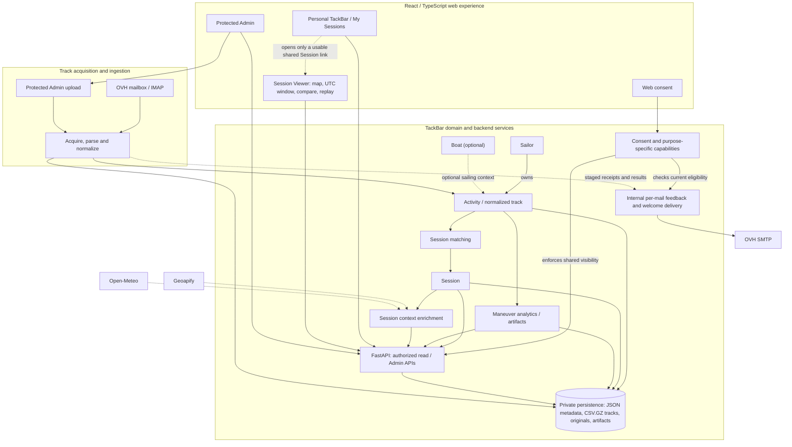

# TackBar — Solution Overview

**Status:** Informational map of the accepted current solution; not a separate functional contract.

This diagram provides a navigational overview of TackBar's main functional
responsibilities and their relationships. It is intentionally schematic:
arrows indicate relevant relationships or data/control flows, not individual
API calls, exact runtime execution order, deployment topology, or a complete
software-component inventory.

The eight domain specifications linked below remain authoritative for their
respective behavior. An approved change to a domain must be reflected in its
own current specification; this overview is updated only when that change
materially affects the map.

## Functional map

## Reading the map

- **Track processing and sharing are separate:** consent does not block
  technical ingestion or Session matching. The backend enforces current
  `ACTIVE`-only visibility in shared Session responses.
- **Sailor, Boat, Activity and Session are distinct domain concepts.**
  An Activity belongs to one Sailor, may reference a Boat, and is associated
  with at most one Session.
- **Personal TackBar is a participation history, not a bypass into a Session.**
  Opening a Session still requires a currently usable shared capability.
  Original Session, Personal, consent-request and temporary-QR credentials
  serve different purposes.
- **The Viewer uses one ephemeral shared GPS/UTC Analysis Window,**
  analytically compares at most two selected Activities, and supports replay.
  It does not persist the selected analysis window as a domain entity.
- **Maneuver analytics are evidence-based.** Candidate events are not
  automatic tack/gybe classifications.
- **Session context is optional and descriptive.** Historical/modelled
  weather and marine values are not onboard measurements and do not enter
  sailing analytics.
- **Providers and storage are backend concerns.** The frontend consumes
  APIs, not private files; acquisition and context providers remain replaceable.
- **Per-mail feedback is an internal staged flow.** It is not connected to the
  current scheduled or Admin OVH mailbox-review trigger.

## Authoritative specifications

| Area in the map | Governing current specification |
| --- | --- |
| Sailor, Boat, Activity, Session and matching | [Domain and Sessions](domain-and-sessions.md) |
| Acquisition, parsing, normalization and persistence | [Ingestion and Data](ingestion-and-data.md) |
| Consent, visibility and capabilities | [Access and Consent](access-and-consent.md) |
| Shared Viewer, selection, UTC analysis and replay | [Session Viewer](session-viewer.md) |
| Maneuver detection, measures and artifacts | [Analytics](analytics.md) |
| Personal history and opening Sessions | [Personal TackBar](personal-tackbar.md) |
| Protected operations and manual upload | [Admin](admin.md) |
| Geography and historical weather/marine context | [Session Context](session-context.md) |

## Maintenance

Keep this page **descriptive, compact and non-normative**. When a scoped,
approved change alters the main modules or their relationships:

1. Update the authoritative affected specification as required by the
   approved Issue or task and repository governance.
2. Adjust the Mermaid source here in the **same authorized documentation
   scope**, without introducing new product guarantees.
3. Review that the diagram remains consistent with the corresponding
   implementation evidence and avoids depicting deferred integrations
   as delivered.

A Miro or other whiteboard representation is a collaborative copy, not the
source of truth for this Markdown/Mermaid diagram.
