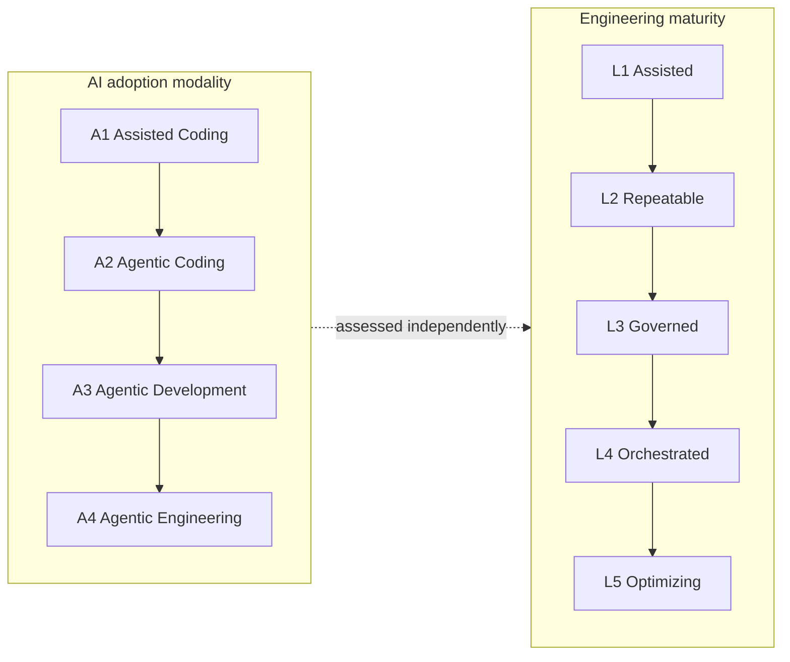
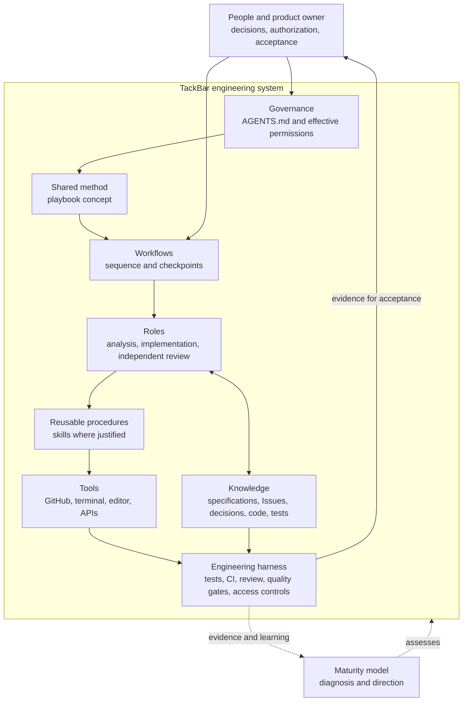
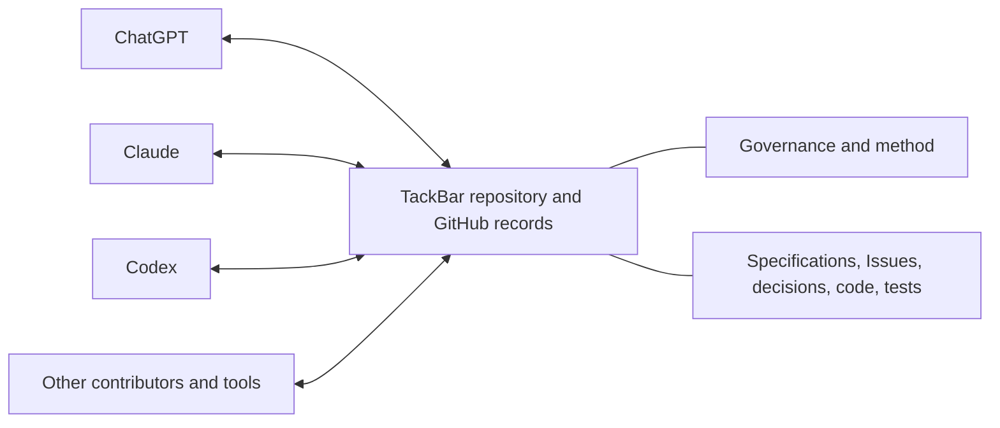
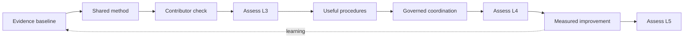

# TackBar Agentic Software Engineering Maturity Model (v0.1)

This is a non-normative engineering reference for TackBar, an open-source sailing debriefing proof of concept and a living lab for AI-assisted development and testing. It describes capabilities to develop and assess, not permissions, product requirements, or a certified maturity rating. Engineering improvements accompany normal product work; they do not require a product release.

The immediate aim is to consolidate L3 through a method that contributors can find and use from the repository. [AGENTS.md](../../AGENTS.md) governs agent authority; the [AI Development Guidelines](../ai-development-guidelines.md) give engineering principles; [current specifications](../current/index.md) own product behavior. An approved Issue defines a bounded change. This model cannot authorize one.

## Adoption principles

- **Continuity and minimalism:** preserve working practices and add artifacts or automation only for demonstrated needs.
- **Repository first:** keep durable shared knowledge and decisions discoverable through the repository and GitHub Issues, without requiring private conversation history.
- **Platform independence:** separate the method from the AI tools and models that use it.
- **Adoptability:** enable people to contribute with their own authorized tools and agents.
- **Evidence:** judge capabilities by observed use and outcomes, not by document count or autonomy alone.
- **Human authority:** retain decisions, authorization, review, and acceptance under the project's current governance.

## Adoption modalities and maturity levels

The A scale describes the scope of AI participation. The L scale assesses engineering capability. They are independent: coordinating several agents does not establish governance or test quality, and a mature team may choose one agent or none for a task.

| Modality | Scope of AI participation | Typical unit |
| --- | --- | --- |
| A1 — AI-Assisted Coding | Help with code, questions, or tests. | Local activity |
| A2 — Agentic Coding | An agent investigates, changes files, tests, and iterates toward an objective. | Development task |
| A3 — Agentic Software Development | Agents contribute to analysis, implementation, testing, review, and delivery. | Product increment |
| A4 — Agentic Software Engineering | People govern and improve the whole engineering system, including knowledge, quality, security, and authority. | Product lifecycle |

The arrows show conceptual progression, not a required increase in autonomy. No A modality maps directly to an L level.

| Level | Demonstrable capability | Indicative evidence |
| --- | --- | --- |
| L1 — Assisted | AI assists development and testing. | AI-assisted changes or tests checked by a contributor. |
| L2 — Repeatable | Shared context, conventions, repeatable processes, and automated tests. | A repeated documented workflow, runnable tests, and traceable results. |
| L3 — Governed | A shared method, explicit responsibilities and authority, independent verification, and contributor adoptability. | Repository-accessible method, observed review and CI evidence, and an onboarding check without private context. |
| L4 — Orchestrated | Coordinated agents, reusable procedures, and evidence-controlled autonomy. | Procedures used in real work, authorized coordination, effective stop conditions, and demonstrated portability. |
| L5 — Optimizing | Improvement guided by measurements and experiments. | A measured baseline, comparable experiments, justified decisions, and later outcome checks. |

Levels are cumulative; advanced practices can appear before their level is consolidated. L3 is the near-term target. L4 and L5 are pursued when they solve real problems. L5 does not require full autonomy.

### Assessment dimensions and evidence

| Dimension | Examine |
| --- | --- |
| Method & Knowledge | Shared method, specifications, decision records, context, and contributor entry points. |
| Governance | Responsibilities, authorization, permissions, constraints, and observed enforcement. |
| Agents & Workflows | Roles, reusable procedures, coordination, and checkpoints. |
| Testing & Delivery | Contract-focused tests, independent review, CI, traceability, and acceptance. |
| Continuous Improvement | Learning, measurement, experiments, and method changes. |

For each applicable capability, record **demonstrated**, **partial**, **pending**, or **not verified**, with a link to evidence or an explicit gap. Mark a criterion inapplicable only with a reason. Do not use weights or a numeric average. A level is consolidated only when its applicable criteria and those of all earlier levels are demonstrated; record higher-level practices separately. Missing evidence does not establish a level.

The actual inventory, assessed SHA, evidence, and diagnosis belong in the subsequent `assessment.md` increment. This document makes no claim about TackBar's verified level.

## Conceptual engineering architecture

Governance sets authority; a shared method explains collaboration; workflows order work; roles assign responsibilities; reusable procedures explain specific activities; tools execute them. Shared knowledge and an engineering harness make results inspectable. These are conceptual responsibilities, not a declaration that every proposed artifact exists. A role need not be a separate technical agent, and diagram arrows grant no permissions.

Existing role and release workflow files retain their current authority and procedure. Proposed playbook, skills, or decision records are candidates only; creating or changing them requires separately approved scope. Significant architectural decisions may merit an ADR when authorized, without replacing current specifications or governance. [Issue #217](https://github.com/maxsail-project/tackbar/issues/217) owns its separate governance consolidation proposal; [Issue #229](https://github.com/maxsail-project/tackbar/issues/229) owns the codebase audit.

The **engineering harness** is the context and controls that make agent work verifiable: technical constraints, tests, static analysis, CI, independent review, security checks, and effective permissions. It can use existing tools. AI may help create and test software; tests and review also provide evidence for bounded autonomy. Distinguish an agent's reported results from independent verification, human acceptance, publication, and deployment. Passing CI alone neither proves complete correctness nor expands authority.

## Platform independence

The repository and traceable GitHub records are the shared reference. ChatGPT, Claude, Codex, other tools, and human contributors consume them through their available interfaces. Tool-specific adapters may help discovery, but should point to a single source for each rule or procedure. Access and write authority still depend on current permissions.

Portability requires a representative use check; tools do not necessarily discover the same files or support the same actions. Private discussions can inform decisions, but durable knowledge needed to continue work belongs in an authorized shared artifact. Do not publish credentials, private data, or sensitive operational details.

## Adoption direction and contributor check

The **Product Roadmap** improves the sailing product. The complementary **Engineering Roadmap** improves how TackBar is built and tested. Both use bounded GitHub Issues, approval, validation, and evidence. The engineering roadmap does not change product contracts or grant release authority. Its detailed priorities and acceptance criteria belong in the subsequent `roadmap.md` increment.

Conceptually, adoption proceeds from an evidence baseline to a repository-accessible method and contributor check, then to reusable procedures and coordinated delivery where justified, and finally to measured improvement. These are candidates for separately authorized work, not completed milestones or automatic prerequisites for ongoing testing and security improvements.

A clean session or new contributor should be able to find the [contribution entry point](../../CONTRIBUTING.md), governing rules, applicable product contracts, role and stop conditions; distinguish an Issue proposal from implementation authorization; carry out or simulate a bounded increment; locate tests and review evidence; and know who accepts it and which Git or release actions are authorized. Record friction and missing context. A clean-session simulation is weaker evidence than an actual new contributor completing the workflow; neither should be reported as successful without observation.

For later improvement experiments, use recoverable Issue, commit, and CI evidence where practical: delivery time, unexpected human interventions, correction cycles, first-pass review and CI outcomes, or confirmed defects after acceptance. Compare similar risk and complexity, record model and environment differences, and avoid causal claims from small samples. Collection is a candidate, not an immediate reporting obligation.

This TackBar model draws inspiration from the [GitLab AI-Assisted Development Playbook](https://handbook.gitlab.com/handbook/engineering/workflow/ai-assisted-development/) and [DORA AI Capabilities Model](https://dora.dev/ai/capabilities-model/report/); it does not adopt their scales or certification. Revisit its criteria when observed work justifies a change. Keep baseline findings in the assessment, priorities in the engineering roadmap, and approved work in Issues.
